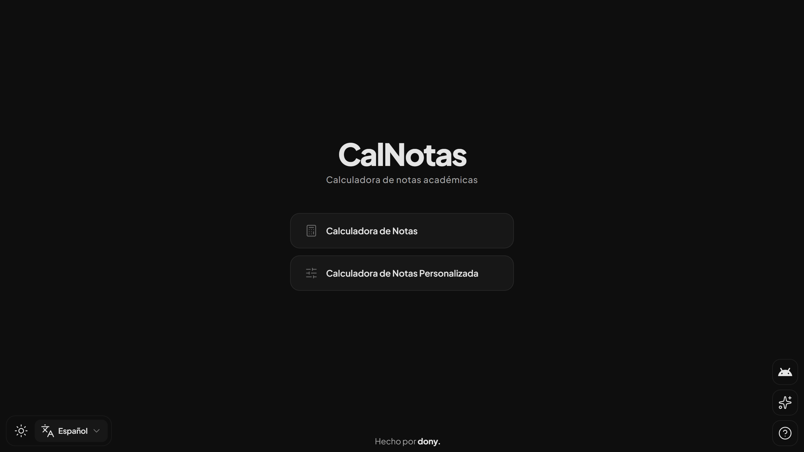

# CalNotas

> Calculadora de notas para estudiantes de la Universidad Americana (Colombia): tu nota por cortes y cuánto te falta para aprobar.

[](README.md)



## Qué hace

CalNotas toma las notas formativa y cognitiva de cada uno de los tres cortes, aplica los porcentajes de la universidad y muestra la nota de cada corte y la definitiva, de 0 a 5. La nota aprobatoria es 3.0.

Mientras faltan notas, también te dice el mínimo que necesitas en las restantes para aprobar.

## Funcionalidades

### Calculadora predeterminada

- Trae los porcentajes 2025 de la Universidad Americana, así que solo ingresas tus notas.
- Recalcula mientras escribes.
- Un panel de predicción muestra la nota mínima uniforme que necesitas en cada campo vacío para llegar a 3.0. También avisa cuando ya aprobaste o cuando ni con 5.0 te alcanza.
- Cada campo vacío muestra una sugerencia (`Sugerido: ≥ X.X`). Si una sola nota basta para aprobar, el campo siguiente lo indica.
- Una ventana de ayuda explica el sistema con un ejemplo resuelto, y un botón borra todos los campos.

### Calculadora personalizada

- Añade los campos que necesites, cada uno con su nombre y su porcentaje.
- Define tu propia nota aprobatoria (3.0 por defecto).
- Los porcentajes deben sumar 100%.
- La configuración se guarda en el navegador para la próxima vez.

### En toda la app

- Tema claro y oscuro.
- Español e inglés.
- Funciona en celular, tablet y computador.
- Una ventana de novedades resume los cambios de la última versión.
- También hay app para Android: la [página de descarga](https://calnotas.vercel.app/app-download) enlaza al último APK en [dony-aep/calnotas](https://github.com/dony-aep/calnotas/releases/latest).

## Acceso

[https://calnotas.vercel.app/](https://calnotas.vercel.app/)

## Sistema de evaluación 2025

| Corte | Formativa | Cognitiva | Total |
|-------|-----------|-----------|-------|
| Corte 1 | 15% | 15% | 30% |
| Corte 2 | 15% | 15% | 30% |
| Corte 3 | 20% | 20% | 40% |

### Ejemplo

Con una nota formativa de 4.5 y una cognitiva de 3.0 en todos los cortes:

```
Corte 1: (4.5 × 0.15) + (3.0 × 0.15) = 1.13
Corte 2: (4.5 × 0.15) + (3.0 × 0.15) = 1.13
Corte 3: (4.5 × 0.20) + (3.0 × 0.20) = 1.50
Total:   1.13 + 1.13 + 1.50 = 3.76
```

3.76 es mayor o igual que 3.0, así que este estudiante aprueba.

## Stack tecnológico

- **Framework:** Angular 22
- **Estilos:** CSS con variables (temas claro/oscuro)
- **Iconos:** Lucide y Simple Icons
- **i18n:** ngx-translate (español/inglés)
- **Tests:** Vitest sobre jsdom
- **Despliegue:** Vercel

## Desarrollo

```bash
npm start                  # Servidor de desarrollo en http://localhost:4200
npm run build              # Build de producción
npm test                   # Tests (modo watch)
npx ng test --watch=false  # Tests, una sola pasada
```

## Créditos

Desarrollado por [dony.](https://github.com/dony-aep)

## Licencia

[MIT](LICENSE)
