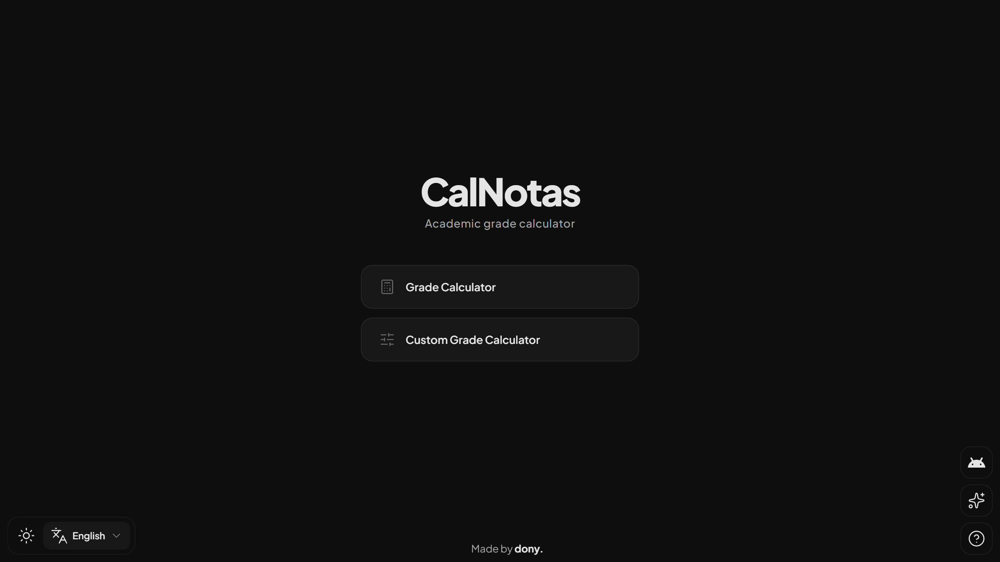

# CalNotas

> Grade calculator for students at Universidad Americana (Colombia): your grade per cut, and how much you still need to pass.

[](README.es.md)



## What it does

CalNotas takes the formative and cognitive grades of each of the three cuts, applies the university's percentages and shows the grade for each cut and the final grade, from 0 to 5. The passing grade is 3.0.

While some grades are still missing, it also tells you the minimum you need in the remaining ones to pass.

## Features

### Default calculator

- Comes with the Universidad Americana 2025 percentages, so you only enter your grades.
- Recalculates as you type.
- A prediction panel shows the minimum uniform grade you need in every empty field to reach 3.0. It also tells you when you have already passed, or when even a 5.0 would not be enough.
- Each empty field shows a hint (`Suggested: ≥ X.X`). When a single grade is enough to pass, the next field says so.
- A help window explains the system with a worked example, and a button clears every field.

### Custom calculator

- Add as many fields as you need, each with its own name and percentage.
- Set your own passing grade (3.0 by default).
- Percentages must add up to 100%.
- The configuration is saved in the browser for next time.

### Everywhere

- Light and dark theme.
- Spanish and English.
- Works on phones, tablets and desktop.
- A "What's new" window shows what changed in the latest version.
- There is also an Android app: the [download page](https://calnotas.vercel.app/app-download) links to the latest APK in [dony-aep/calnotas](https://github.com/dony-aep/calnotas/releases/latest).

## Access

[https://calnotas.vercel.app/](https://calnotas.vercel.app/)

## 2025 grading system

| Cut | Formative | Cognitive | Total |
|-----|-----------|-----------|-------|
| Cut 1 | 15% | 15% | 30% |
| Cut 2 | 15% | 15% | 30% |
| Cut 3 | 20% | 20% | 40% |

### Example

With a formative grade of 4.5 and a cognitive grade of 3.0 in every cut:

```
Cut 1: (4.5 × 0.15) + (3.0 × 0.15) = 1.13
Cut 2: (4.5 × 0.15) + (3.0 × 0.15) = 1.13
Cut 3: (4.5 × 0.20) + (3.0 × 0.20) = 1.50
Total: 1.13 + 1.13 + 1.50 = 3.76
```

3.76 is at least 3.0, so this student passes.

## Tech stack

- **Framework:** Angular 22
- **Styles:** CSS with variables (light/dark themes)
- **Icons:** Lucide and Simple Icons
- **i18n:** ngx-translate (Spanish/English)
- **Tests:** Vitest on jsdom
- **Deployment:** Vercel

## Development

```bash
npm start                  # Dev server at http://localhost:4200
npm run build              # Production build
npm test                   # Tests (watch mode)
npx ng test --watch=false  # Tests, single run
```

## Credits

Developed by [dony.](https://github.com/dony-aep)

## License

[MIT](LICENSE)
